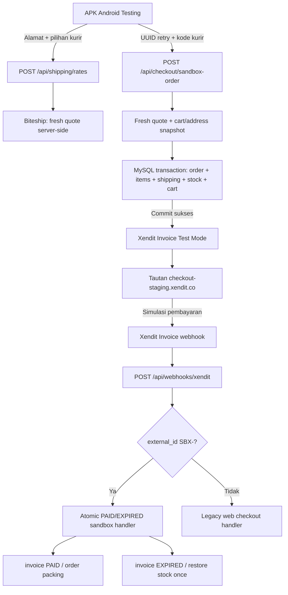

# OneTone — Android Checkout → Xendit Test: Milestone & Runbook

**Tanggal:** 7 November 2026  
**Lingkungan:** Kanuraga staging only  
**Status:** Order + pengurangan stok **terkonfirmasi dari UAT pengguna**; simulasi pembayaran, callback PAID/EXPIRED, serta regressions **belum terkonfirmasi**.  
**Kode:** Backend `one2pret/onetone-store`; Flutter `one2pret/onetone-mobile`.  
**Bukan:** Persetujuan go-live production / pembayaran nyata.

## Mulai dari sini (ringkasan 60 detik)

UAT pada APK Android testing menunjukkan:
- Daftar kurir Biteship berhasil dimuat dan salah satu layanan dipilih.
- Contoh layar: subtotal Rp19.500.000 + ongkir Rp9.000 = **estimasi Rp19.509.000** (produk dummy bernilai tinggi; **bukan** bukti pembayaran).
- Tombol `Buat Pesanan — TESTING` berhasil membuat order dengan awalan `SBX-`.
- Android menampilkan tautan `checkout-staging.xendit.co` untuk invoice Test Mode.
- Penguji memeriksa backend dan melaporkan **stok staging berkurang** setelah pesanan dibuat.

**Belum ada bukti bahwa invoice telah PAID, webhook berhasil diterima, atau stok telah dipulihkan pada EXPIRED.** Jangan menyatakan checkout end-to-end/production lulus sebelum ketiganya diuji. Jangan masukkan URL invoice utuh, secret, customer PII atau token ke Git.

## Gambaran arsitektur



**Mengapa stok sudah berkurang sebelum PAID?** Jalur sandbox saat ini mengurangi stok saat order dibuat dan mengembalikannya melalui callback invoice EXPIRED. Ini **perilaku saat ini**, bukan keputusan final untuk pengelolaan reservasi stok production.

## UAT tahap 1 — Lanjutkan dengan invoice yang sudah dibuat

**Jangan membuat order baru** hanya karena ingin membuktikan pembayaran. Buka invoice TEST yang **sudah ditampilkan** oleh APK Android.

1. Pastikan dashboard Xendit berada di **Test Mode**, bukan Live.
2. Di APK pilih **Salin tautan Xendit TEST**, lalu buka di browser. Periksa domain benar-benar `checkout-staging.xendit.co` dan invoice memang ditandai sebagai simulasi/test.
3. Pilih metode pembayaran simulasi yang tersedia di invoice. Untuk **legacy Invoice Test Mode**, Xendit Help Center menjelaskan bahwa pembayaran dapat disimulasikan melalui **banner merah** di bagian atas halaman invoice. Ikuti petunjuk yang muncul; **jangan** menggunakan uang, transfer bank, kartu, atau kredensial nyata.
4. Buka **Xendit Test Mode → Webhook Logs**. Temukan callback Invoice PAID dengan external ID order SBX yang relevan; lihat HTTP response (harapkan 200), waktu, dan status pengiriman. Jangan salin raw token/header.
5. Pada backend staging, periksa status invoice `paid`, order `packing`, dan hanya **satu** transisi `waiting_payment → packing`. Pastikan stok tidak berkurang kedua kalinya ketika callback diproses.
6. Jika webhook gagal (401/409/422/503), **berhenti** dan analisa log dahulu. Jangan mengirim PAID palsu langsung ke database atau mengulangi checkout dengan order baru.

**Rujukan resmi:** https://help.xendit.co/hc/en-us/articles/4406696409357-How-can-I-simulate-payment-using-invoice-on-test-mode

## UAT tahap 2 — Pemeriksaan database read-only

Hanya oleh administrator berwenang pada **database staging**. Jangan jalankan UPDATE/DELETE, jangan menampilkan data alamat, telepon, atau invoice URL ke chat/PR. Contoh SQL di bawah menggunakan **parameter**: gantikan placeholder dengan ID order pengujian pada client SQL, bukan dipublikasikan.

```sql
-- 1) Kondisi order dan nominal (gunakan nilai SBX-... milik UAT sendiri)
SELECT id, order_number, status, subtotal, shipping_cost, total, created_at, paid_at
FROM orders
WHERE order_number = ?;

-- 2) Kondisi invoice (tanpa menampilkan invoice_url/xendit_id)
SELECT id, order_id, status, amount, created_at, paid_at, expired_at
FROM invoices
WHERE order_id = ?;

-- 3) Histori status
SELECT from_status, to_status, changed_by, created_at
FROM order_status_logs
WHERE order_id = ?
ORDER BY id;

-- 4) Mutasi stok untuk order itu
SELECT product_id, variant_id, location_id, type, quantity_delta, balance_after, created_at
FROM inventory_movements
WHERE reference_type = 'order' AND reference_id = ?
ORDER BY id;

-- 5) Jumlah dan stok yang tercatat (read-only)
SELECT product_id, variant_id, location_id, quantity, reserved
FROM inventory_balances
WHERE product_id = ?;
```

Bila memakai mysql CLI dan bukan parameterized SQL client, **jangan** menyalin simbol `?` mentah; jalankan melalui client yang mendukung parameter atau ganti dengan ID numerik yang telah diperiksa. Hindari mengeksekusi SQL pada `onetone-db` production.

### Hasil yang diharapkan

| Kejadian | Invoice | Order | Stok |
|---|---|---|---|
| Order pertama berhasil, belum dibayar | `pending` | `waiting_payment` | Turun sekali saat commit order |
| Xendit Test Mode PAID | `paid` | `packing` | Tidak turun lagi |
| Callback PAID yang sama diulang | `paid` | `packing` | Tidak ada mutasi baru |
| Invoice lain sengaja dibiarkan EXPIRED | `expired` | `expired` | Dipulihkan sekali di lokasi asal |
| Callback EXPIRED diulang | `expired` | `expired` | Tidak dipulihkan kedua kali |
| PAID datang setelah EXPIRED | perlu rekonsiliasi | **jangan** ubah otomatis | Perlu keputusan admin |

**Catatan:** baris EXPIRED perlu **order pengujian terpisah** dan UAT tidak boleh dimulai sebelum order pertama selesai direkonsiliasi. Gunakan produk dummy harga kecil untuk pengujian lanjutan.

## UAT tahap 3 — Pemeriksaan webhook + backend

Callback invoice Xendit Test Mode tetap di:

`https://onetone.kanuraga.web.id/api/webhooks/xendit`

Dispatcher `SBX-` berjalan di endpoint ini; jangan mengarahkannya ke URL sandbox-only dan jangan mengubah callback Live Mode.

Cek environment dengan aman (tidak menampilkan secret):

```bash
docker exec onetone-app sh -c '
if [ "$CHECKOUT_SANDBOX_ORDER_ENABLED" = true ]; then echo SANDBOX_ORDER=ENABLED; else echo SANDBOX_ORDER=DISABLED; fi
case "$XENDIT_SECRET_KEY" in xnd_development_*) echo XENDIT_MODE=TEST ;; *) echo XENDIT_MODE=OTHER ;; esac
if [ -n "$XENDIT_WEBHOOK_TOKEN" ]; then echo WEBHOOK_TOKEN=SET; else echo WEBHOOK_TOKEN=MISSING; fi
'
```

Untuk memeriksa log terbaru tanpa membocorkan token, buka terminal VPS dan filter pada **waktu UAT**. Jangan publikasikan payload mentah di GitHub atau chat.

```bash
docker logs --since 15m --tail 250 onetone-app 2>&1 | grep -E 'Sandbox|Xendit|invoice|webhook|error' || true
```

Output bisa berisi informasi sensitif; **tinjau dan redaksi secara lokal** sebelum berbagi. Log yang kosong tidak membuktikan callback sukses; periksa **Xendit Webhook Logs** dan status database.

## Troubleshooting cepat

| Gejala | Kemungkinan penyebab | Aksi aman |
|---|---|---|
| `404 Not available` dari sandbox-order | Flag staging nonaktif / Xendit key bukan dev | Periksa GitHub variable `CHECKOUT_SANDBOX_ORDER_ENABLED_TEST`, env container dan deploy |
| HTTP 401 dari POST tanpa token | Endpoint aktif, perlu autentikasi | Normal untuk smoke test anonim |
| Quote 409 / 422 | Tarif berubah, berat/koordinat/stock invalid | Refresh ongkir; periksa master produk |
| Order ada tapi payment URL tidak muncul (`202`) | Invoice remote/local belum pasti sinkron | Rekonsiliasi Xendit berdasarkan external ID; jangan membuat invoice ulang |
| Invoice berhasil dibayar di Xendit, tetapi status order masih `waiting_payment` | Callback gagal, tidak sampai atau token salah | Periksa Webhook Logs, HTTP code, token test-mode, source backend; **jangan paksa status** |
| Invoice EXPIRED tetapi stok belum pulih | Webhook gagal, movement tidak konsisten, atau konflik state | Periksa log/movement dan lakukan rekonsiliasi manual |
| Stok berubah berkali-kali | Potensi bug konkurensi/duplikasi event | Hentikan UAT dan rollback gate, kumpulkan bukti, jangan edit database sembarangan |

## Bukti yang perlu dicatat untuk acceptance

- [x] APK testing menampilkan pilihan kurir dan total.
- [x] Order `SBX-` dibuat dan invoice staging ditampilkan (laporan + screenshot UAT pengguna).
- [x] Pengguna melaporkan stok staging berkurang.
- [ ] Screenshot/status Xendit Test Mode **PAID**.
- [ ] Status `invoices.paid` dan `orders.packing` sesudah webhook.
- [ ] Histori PAID tepat sekali meski event diulang.
- [ ] Skenario EXPIRED + restore stok tepat sekali.
- [ ] Skenario konflik terminal / kegagalan invoice.
- [ ] Regression website checkout staging.
- [ ] Full-commerce security review sebelum production.

Bukti screenshot disimpan di lokasi internal aman, **bukan** di Git karena dapat berisi URL invoice/PII.

## Keputusan berikutnya setelah PAID berhasil

1. **Milestone M1:** Luluskan invoice PAID end-to-end, verifikasi order + DB status + history.
2. **Milestone M2:** EXPIRED/duplicate/late callbacks, idempotency dan UAT konkurensi stok.
3. **Milestone M3:** UX Android — buka pembayaran, halaman hasil order, refresh status, recovery pending payment/idempotency. Build signed testing APK.
4. **Milestone M4:** Perbaiki checkout **web lama**: jangan percaya `courierPrice` dari client, satukan transaksi stok/order, tangani invoice uncertain, dan amankan webhook loyalty/affiliate.
5. **Milestone M5:** Test regression + backup + monitoring + rollback; live key production terpisah; izin launch production setelah semua gerbang lolos.

Jangan melewati M1/M2 karena ada nomor order atau Xendit payment link. **Pembuatan invoice belum sama dengan invoice PAID.**

## Referensi source of truth

- `app/api/checkout/sandbox-order/route.ts` — route order dengan gate test-only.
- `lib/checkout/commit-sandbox-order.ts` — atomic order, inventory, cart.
- `app/api/webhooks/xendit/route.ts` — satu URL Xendit Invoice Test Mode.
- `lib/checkout/process-sandbox-webhook.ts` — paid/expired, restoring original stock.
- `docs/uat/xendit-single-invoice-callback-20261106.md` — konfigurasi dan callback replay.
- `docs/runbooks/staging-sandbox-checkout-persistence-20261107.md` — persistensi flag GitHub Actions.
- `docs/uat/staging-sandbox-order-20261105.md` — threat model dan gated checkout.
- `one2pret/onetone-mobile/docs/ai/SANDBOX_CHECKOUT_UAT_20261106.md` — APK testing.
- Official Xendit legacy invoices migration context: https://docs.xendit.co/v1/docs/migrate-to-payment-session
