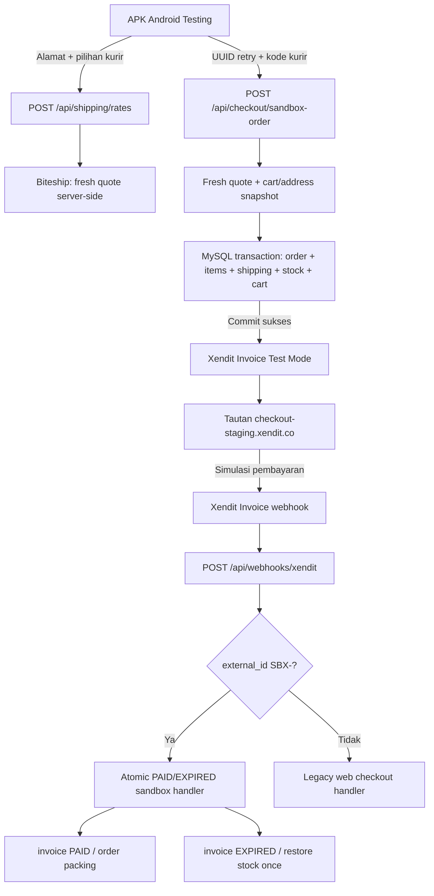

# OneTone — Android Checkout → Xendit Test: Milestone & Runbook

**Tanggal:** 7 November 2026  
**Lingkungan:** Kanuraga staging only  
**Status:** Order + stok + Xendit TEST PAID callback HTTP 200 + status `packing` dari `webhook:xendit:sandbox` **terkonfirmasi**. UAT duplikasi, EXPIRED, shipment dan regresi **belum terverifikasi**.  
**Kode:** Backend `one2pret/onetone-store`; Flutter `one2pret/onetone-mobile`.  
**Bukan:** Persetujuan go-live production / pembayaran nyata.

## Acceptance update — 9 November 2026: webhook PAID verified

**Milestone PAYMENT PAID is confirmed by screenshots from Xendit Test Mode and OneTone staging admin.** This supersedes earlier notes saying webhook status is unknown.

Observed evidence for the original SBX order:
- Xendit **Test Mode** → Webhook Details → event **Invoices paid**, status **Completed**.
- Event body: `status=PAID`, amount `19509000` (Rp19.509.000), paid at **7 Nov 2026 20:15 WIB**.
- Delivery endpoint: `https://onetone.kanuraga.web.id/api/webhooks/xendit`.
- Webhook delivery: **HTTP 200**, response `{"success":true,"result":"paid","orderId":31}`; received at 20:15:41 WIB.
- OneTone staging admin: invoice **Paid**, order **Dikemas / packing**; history `waiting_payment → packing` explicitly attributed to **`webhook:xendit:sandbox`**.

**Conclusion:** The new sandbox webhook — not the legacy website fallback — performed this payment transition. Order/stock commit was previously observed by the user. **This does NOT prove** duplicate callback replay, EXPIRED stock restoration, no double stock mutation under concurrency, or external Biteship shipment creation. Do not count this Test Mode amount as real revenue.

**Safe next tests:**
1. After preserving a before-snapshot of `order_status_logs` and `inventory_movements`, use Xendit Test Mode **Resend** once on this already-paid event. Confirm response `200` with `result=duplicate`, and no new status log/movement. Do not re-simulate payment or create another order.
2. **Do not test EXPIRED yet** until sandbox protection against the legacy cron/admin/cancel/repay/shipping actions has passed CI and deployed to staging.
3. Then create **one separate cheap dummy pending TEST order**, let the Xendit invoice expire, and verify `EXPIRED` is handled once by `webhook:xendit:sandbox` with one corresponding stock restoration in the original warehouse.
4. Test proper handling of conflicting/late events and ambiguous invoice creation separately before a production release.

### Newly identified operational risks

Code audit shows several **legacy paths** still need to exclude `SBX-` orders:
- `app/api/cron/check-expired-orders/route.ts` previously expired `waiting_payment` orders using non-atomic legacy `restoreStock`.
- `cancelOrderByAdmin` could cancel a **paid** sandbox order and restore stock without completing a real refund.
- `cancelOrderByCustomer`, `repayOrder` and manual status changes can bypass the sandbox stock/payment state machine.
- Admin **Kirim Order ke Kurir** calls `sendOrderToBitship`, which invokes **`createShipment`**. This may create an actual external shipment depending on Biteship credentials; it is NOT a harmless preview.

**Do not press** Kirim Order ke Kurir, Batalkan Pesanan or Ubah Status on this paid SBX test order. A separate sandbox-safe fulfillment/cancellation/refund workflow is required before those features are enabled. The accompanying protection PR prevents known legacy calls for SBX orders and leaves normal web orders unchanged.

Also note the uploaded admin screenshots contain recipient personal information. Redact phone, email, full address and long invoice/order identifiers before putting screenshots in shared documents or GitHub issues.

## Mulai dari sini (ringkasan 60 detik)

UAT pada APK Android testing menunjukkan:
- Daftar kurir Biteship berhasil dimuat dan salah satu layanan dipilih.
- Contoh layar: subtotal Rp19.500.000 + ongkir Rp9.000 = **estimasi Rp19.509.000** (produk dummy bernilai tinggi; **bukan** bukti pembayaran).
- Tombol `Buat Pesanan — TESTING` berhasil membuat order dengan awalan `SBX-`.
- Android menampilkan tautan `checkout-staging.xendit.co` untuk invoice Test Mode.
- Penguji memeriksa backend dan melaporkan **stok staging berkurang** setelah pesanan dibuat.

**Belum ada bukti bahwa invoice telah PAID, webhook berhasil diterima, atau stok telah dipulihkan pada EXPIRED.** Jangan menyatakan checkout end-to-end/production lulus sebelum ketiganya diuji. Jangan masukkan URL invoice utuh, secret, customer PII atau token ke Git.

## Pembaruan UAT — 7 November 2026 malam

**Bukti baru dari screenshot pengguna:** setelah melakukan simulasi pembayaran Xendit Test Mode dan membuka order yang sama di website Kanuraga, halaman detail menunjukkan status **Dikemas / `packing`**. Total tetap Rp19.509.000 dan detail pengiriman tersedia.

**Batas bukti:** screenshot **belum membuktikan** apakah transisi ke `packing` diproses oleh callback `webhook:xendit:sandbox` atau oleh mekanisme fallback halaman `syncOrderPayment`. Audit `app/(checkout)/orders/[id]/page.tsx` dan `app/actions/orders.ts` menemukan bahwa halaman menghubungi Xendit langsung saat order masih `waiting_payment` dan kemudian dapat memperbarui invoice/order tanpa transaksi stok yang sama. Saat EXPIRED, fallback lama memanggil `restoreStock` yang bukan jalur `SBX-` atomik. **Jangan melakukan UAT EXPIRED/duplikasi sebelum perbaikan sinkronisasi ini diterapkan.**

PR terpisah terkait milestone ini menonaktifkan fallback legacy khusus `SBX-`, mewajibkan akses pemilik/admin untuk detail order, dan membungkus nomor order panjang pada layar mobile.

### Verifikasi sumber status (read-only)

Lakukan pada **database staging** dengan akses admin. Jangan unggah nomor order penuh, Xendit ID, token, alamat, nomor telepon, atau isi baris sensitif ke issue/chat.

```sql
-- Pada sesi SQL staging. Isi SBX hanya secara lokal.
SET @uat_order_number = 'SBX-ISI-NOMOR-DARI-APK';

SELECT o.id, o.status AS order_status, o.paid_at AS order_paid_at,
       i.status AS invoice_status, i.paid_at AS invoice_paid_at
FROM orders o LEFT JOIN invoices i ON i.order_id = o.id
WHERE o.order_number = @uat_order_number;

SELECT l.from_status, l.to_status, l.changed_by, l.created_at
FROM order_status_logs l
JOIN orders o ON o.id = l.order_id
WHERE o.order_number = @uat_order_number
ORDER BY l.id;

SELECT m.type, m.quantity_delta, m.balance_after, m.created_at
FROM inventory_movements m JOIN orders o ON o.id = m.reference_id
WHERE m.reference_type = 'order' AND o.order_number = @uat_order_number
ORDER BY m.id;
```

Interpretasi `order_status_logs.changed_by`:
- `webhook:xendit:sandbox` = status `packing` berasal dari handler webhook sandbox yang menggunakan transaksi database.
- `sync:xendit` = status datang dari fallback sinkronisasi website, **belum membuktikan webhook**.
- `admin:...` atau nilai lain = perlu audit aktivitas manual.
- **Tidak ada log** = status belum dapat diterima sebagai bukti integritas event; periksa data Xendit Test Mode dan backend.

Halaman order yang menampilkan `Pembayaran 19:56` dan `Dikemas 20:15` menggunakan `createdAt` untuk langkah awal dan `paidAt` untuk langkah kedua. Waktu pada tahap pertama **bukan** timestamp pembayaran selesai.

### Pengiriman belum otomatis

Status `packing` **bukan** bukti bahwa pengiriman sudah dipesan ke Biteship. Endpoint sandbox membuat baris `shippings` yang menyimpan pilihan kurir dan ongkir, tetapi **belum terlihat pembuatan shipment Biteship / AWB/resi** pada alur tersebut. Setelah pembayaran dan webhook PAID/EXPIRED lolos, buat UAT fulfillment terpisah: pembuatan shipment server-side dengan alamat dan paket tervalidasi, simpan nomor resi/tracking, hindari pemesanan kurir duplikat, lalu tampilkan status `shipping` ketika paket benar-benar diserahkan. Jangan memanggil API shipment live sebelum konfigurasi ongkir/sandbox Biteship dipastikan.

### Acceptance baru untuk milestone ini

- [x] Invoice Xendit Test Mode dapat digunakan untuk simulasi pembayaran; pengguna melihat order website berubah menjadi `packing`.
- [ ] `invoices.status='paid'` dan `orders.status='packing'` dikonfirmasi dengan DB read-only.
- [ ] `order_status_logs.changed_by='webhook:xendit:sandbox'` untuk transisi ini, atau temuan `sync:xendit` didokumentasikan dan callback diuji ulang setelah patch.
- [ ] Webhook Logs Xendit Test Mode menunjukkan HTTP 200 untuk `PAID` pada shared callback.
- [ ] Tidak ada pengurangan stok kedua / duplicate status history.
- [ ] Patch pengamanan legacy `syncOrderPayment` dan detail order lolos CI dan UAT.

## Gambaran arsitektur



**Mengapa stok sudah berkurang sebelum PAID?** Jalur sandbox saat ini mengurangi stok saat order dibuat dan mengembalikannya melalui callback invoice EXPIRED. Ini **perilaku saat ini**, bukan keputusan final untuk pengelolaan reservasi stok production.

## UAT tahap 1 — Verifikasi invoice yang sudah disimulasikan (jangan bayar ulang)

**Jangan membuat order baru** hanya karena ingin membuktikan pembayaran. Buka invoice TEST yang **sudah ditampilkan** oleh APK Android.

1. Pastikan dashboard Xendit berada di **Test Mode**, bukan Live.
2. Di APK pilih **Salin tautan Xendit TEST**, lalu buka di browser. Periksa domain benar-benar `checkout-staging.xendit.co` dan invoice memang ditandai sebagai simulasi/test.
3. Pilih metode pembayaran simulasi yang tersedia di invoice. Untuk **legacy Invoice Test Mode**, Xendit Help Center menjelaskan bahwa pembayaran dapat disimulasikan melalui **banner merah** di bagian atas halaman invoice. Ikuti petunjuk yang muncul; **jangan** menggunakan uang, transfer bank, kartu, atau kredensial nyata.
4. Buka **Xendit Test Mode → Webhook Logs**. Temukan callback Invoice PAID dengan external ID order SBX yang relevan; lihat HTTP response (harapkan 200), waktu, dan status pengiriman. Jangan salin raw token/header.
5. Pada backend staging, periksa status invoice `paid`, order `packing`, dan hanya **satu** transisi `waiting_payment → packing`. Pastikan stok tidak berkurang kedua kalinya ketika callback diproses.
6. Jika webhook gagal (401/409/422/503), **berhenti** dan analisa log dahulu. Jangan mengirim PAID palsu langsung ke database atau mengulangi checkout dengan order baru.

**Rujukan resmi:** https://help.xendit.co/hc/en-us/articles/4406696409357-How-can-I-simulate-payment-using-invoice-on-test-mode

## UAT tahap 2 — Pemeriksaan database read-only

Hanya oleh administrator berwenang pada **database staging**. Jangan jalankan UPDATE/DELETE, jangan menampilkan data alamat, telepon, atau invoice URL ke chat/PR. Contoh SQL di bawah menggunakan **parameter**: gantikan placeholder dengan ID order pengujian pada client SQL, bukan dipublikasikan.

```sql
-- 1) Kondisi order dan nominal (gunakan nilai SBX-... milik UAT sendiri)
SELECT id, order_number, status, subtotal, shipping_cost, total, created_at, paid_at
FROM orders
WHERE order_number = ?;

-- 2) Kondisi invoice (tanpa menampilkan invoice_url/xendit_id)
SELECT id, order_id, status, amount, created_at, paid_at, expired_at
FROM invoices
WHERE order_id = ?;

-- 3) Histori status
SELECT from_status, to_status, changed_by, created_at
FROM order_status_logs
WHERE order_id = ?
ORDER BY id;

-- 4) Mutasi stok untuk order itu
SELECT product_id, variant_id, location_id, type, quantity_delta, balance_after, created_at
FROM inventory_movements
WHERE reference_type = 'order' AND reference_id = ?
ORDER BY id;

-- 5) Jumlah dan stok yang tercatat (read-only)
SELECT product_id, variant_id, location_id, quantity, reserved
FROM inventory_balances
WHERE product_id = ?;
```

Bila memakai mysql CLI dan bukan parameterized SQL client, **jangan** menyalin simbol `?` mentah; jalankan melalui client yang mendukung parameter atau ganti dengan ID numerik yang telah diperiksa. Hindari mengeksekusi SQL pada `onetone-db` production.

### Hasil yang diharapkan

| Kejadian | Invoice | Order | Stok |
|---|---|---|---|
| Order pertama berhasil, belum dibayar | `pending` | `waiting_payment` | Turun sekali saat commit order |
| Xendit Test Mode PAID | `paid` | `packing` | Tidak turun lagi |
| Callback PAID yang sama diulang | `paid` | `packing` | Tidak ada mutasi baru |
| Invoice lain sengaja dibiarkan EXPIRED | `expired` | `expired` | Dipulihkan sekali di lokasi asal |
| Callback EXPIRED diulang | `expired` | `expired` | Tidak dipulihkan kedua kali |
| PAID datang setelah EXPIRED | perlu rekonsiliasi | **jangan** ubah otomatis | Perlu keputusan admin |

**Catatan:** baris EXPIRED perlu **order pengujian terpisah** dan UAT tidak boleh dimulai sebelum order pertama selesai direkonsiliasi. Gunakan produk dummy harga kecil untuk pengujian lanjutan.

## UAT tahap 3 — Pemeriksaan webhook + backend

Callback invoice Xendit Test Mode tetap di:

`https://onetone.kanuraga.web.id/api/webhooks/xendit`

Dispatcher `SBX-` berjalan di endpoint ini; jangan mengarahkannya ke URL sandbox-only dan jangan mengubah callback Live Mode.

Cek environment dengan aman (tidak menampilkan secret):

```bash
docker exec onetone-app sh -c '
if [ "$CHECKOUT_SANDBOX_ORDER_ENABLED" = true ]; then echo SANDBOX_ORDER=ENABLED; else echo SANDBOX_ORDER=DISABLED; fi
case "$XENDIT_SECRET_KEY" in xnd_development_*) echo XENDIT_MODE=TEST ;; *) echo XENDIT_MODE=OTHER ;; esac
if [ -n "$XENDIT_WEBHOOK_TOKEN" ]; then echo WEBHOOK_TOKEN=SET; else echo WEBHOOK_TOKEN=MISSING; fi
'
```

Untuk memeriksa log terbaru tanpa membocorkan token, buka terminal VPS dan filter pada **waktu UAT**. Jangan publikasikan payload mentah di GitHub atau chat.

```bash
docker logs --since 15m --tail 250 onetone-app 2>&1 | grep -E 'Sandbox|Xendit|invoice|webhook|error' || true
```

Output bisa berisi informasi sensitif; **tinjau dan redaksi secara lokal** sebelum berbagi. Log yang kosong tidak membuktikan callback sukses; periksa **Xendit Webhook Logs** dan status database.

## Troubleshooting cepat

| Gejala | Kemungkinan penyebab | Aksi aman |
|---|---|---|
| `404 Not available` dari sandbox-order | Flag staging nonaktif / Xendit key bukan dev | Periksa GitHub variable `CHECKOUT_SANDBOX_ORDER_ENABLED_TEST`, env container dan deploy |
| HTTP 401 dari POST tanpa token | Endpoint aktif, perlu autentikasi | Normal untuk smoke test anonim |
| Quote 409 / 422 | Tarif berubah, berat/koordinat/stock invalid | Refresh ongkir; periksa master produk |
| Order ada tapi payment URL tidak muncul (`202`) | Invoice remote/local belum pasti sinkron | Rekonsiliasi Xendit berdasarkan external ID; jangan membuat invoice ulang |
| Invoice berhasil dibayar di Xendit, tetapi status order masih `waiting_payment` | Callback gagal, tidak sampai atau token salah | Periksa Webhook Logs, HTTP code, token test-mode, source backend; **jangan paksa status** |
| Invoice EXPIRED tetapi stok belum pulih | Webhook gagal, movement tidak konsisten, atau konflik state | Periksa log/movement dan lakukan rekonsiliasi manual |
| Stok berubah berkali-kali | Potensi bug konkurensi/duplikasi event | Hentikan UAT dan rollback gate, kumpulkan bukti, jangan edit database sembarangan |

## Bukti yang perlu dicatat untuk acceptance

- [x] APK testing menampilkan pilihan kurir dan total.
- [x] Order `SBX-` dibuat dan invoice staging ditampilkan (laporan + screenshot UAT pengguna).
- [x] Pengguna melaporkan stok staging berkurang.
- [ ] Screenshot/status Xendit Test Mode **PAID**.
- [ ] Status `invoices.paid` dan `orders.packing` sesudah webhook.
- [ ] Histori PAID tepat sekali meski event diulang.
- [ ] Skenario EXPIRED + restore stok tepat sekali.
- [ ] Skenario konflik terminal / kegagalan invoice.
- [ ] Regression website checkout staging.
- [ ] Full-commerce security review sebelum production.

Bukti screenshot disimpan di lokasi internal aman, **bukan** di Git karena dapat berisi URL invoice/PII.

## Keputusan berikutnya setelah PAID berhasil

1. **Milestone M1:** Luluskan invoice PAID end-to-end, verifikasi order + DB status + history.
2. **Milestone M2:** EXPIRED/duplicate/late callbacks, idempotency dan UAT konkurensi stok.
3. **Milestone M3:** UX Android — buka pembayaran, halaman hasil order, refresh status, recovery pending payment/idempotency. Build signed testing APK.
4. **Milestone M4:** Perbaiki checkout **web lama**: jangan percaya `courierPrice` dari client, satukan transaksi stok/order, tangani invoice uncertain, dan amankan webhook loyalty/affiliate.
5. **Milestone M5:** Test regression + backup + monitoring + rollback; live key production terpisah; izin launch production setelah semua gerbang lolos.

Jangan melewati M1/M2 karena ada nomor order atau Xendit payment link. **Pembuatan invoice belum sama dengan invoice PAID.**

## Referensi source of truth

- `app/api/checkout/sandbox-order/route.ts` — route order dengan gate test-only.
- `lib/checkout/commit-sandbox-order.ts` — atomic order, inventory, cart.
- `app/api/webhooks/xendit/route.ts` — satu URL Xendit Invoice Test Mode.
- `lib/checkout/process-sandbox-webhook.ts` — paid/expired, restoring original stock.
- `docs/uat/xendit-single-invoice-callback-20261106.md` — konfigurasi dan callback replay.
- `docs/runbooks/staging-sandbox-checkout-persistence-20261107.md` — persistensi flag GitHub Actions.
- `docs/uat/staging-sandbox-order-20261105.md` — threat model dan gated checkout.
- `one2pret/onetone-mobile/docs/ai/SANDBOX_CHECKOUT_UAT_20261106.md` — APK testing.
- Official Xendit legacy invoices migration context: https://docs.xendit.co/v1/docs/migrate-to-payment-session
